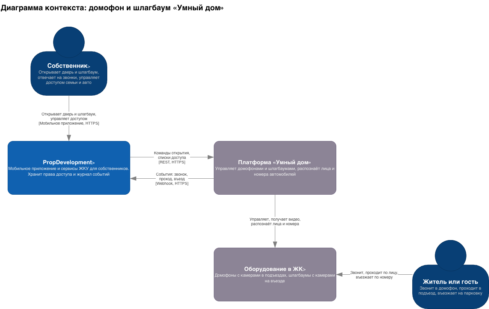
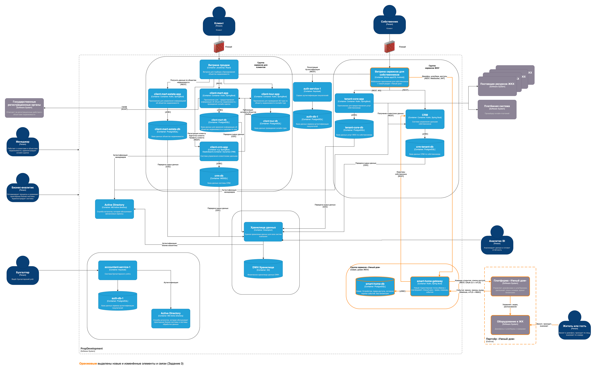

# Задание 3. Внешние интеграции

## Изменения

Партнёр даёт платформу «Умный дом» с двумя услугами: умный домофон (звонок, открытие, проход по лицу) и умный шлагбаум (открытие, въезд по номеру авто). Собственник пользуется ими через текущее мобильное приложение.

Главное решение: мобильное приложение не ходит к партнёру напрямую. Весь обмен идёт через один новый сервис `smart-home-gateway`. Так мы сами проверяем права, контролируем, какие данные уходят партнёру, и пишем журнал. Это закрывает проблему из описания компании, когда интеграции с партнёрами делались без единых правил.

Изменения на диаграмме контейнеров (новое выделено оранжевым):

- **Группа сервисов «Умный дом»** (новая, отдельный блок в домене ЖКУ):
  - **smart-home-gateway** — единственная точка обмена с платформой партнёра;
  - **smart-home-db** — устройства по домам, права доступа, согласия, журнал событий. Биометрию не храним;
- **Партнёр «Умный дом»** (отдельный внешний блок): **Платформа «Умный дом»** и **Оборудование в ЖК**;
- **мобильное приложение** (изменено) — новый раздел «Умный дом».

## Диаграмма контекста

## Диаграмма контейнеров

## 1. Требования к безопасности

1. Весь обмен с партнёром идёт только через `smart-home-gateway`. Других прямых интеграций с платформой нет.
2. Все каналы шифруются (TLS 1.2 и выше). Между `smart-home-gateway` и партнёром — взаимная аутентификация по сертификатам (mTLS).
3. Фото лиц и биометрические шаблоны хранятся только у партнёра. PropDevelopment хранит только идентификаторы, которые вернул партнёр.
4. Биометрия обрабатывается только с письменного согласия человека (152-ФЗ, ст. 11). Согласие можно отозвать в приложении, после этого данные удаляются у партнёра.
5. Номер автомобиля, привязанный к собственнику, — это ПДн. Его тоже передаём только с согласия.
6. Партнёру передаём минимум данных: ID жителя, ID дома и устройства, номер авто. ФИО, телефон и паспортные данные не передаём.
7. Собственник управляет только своим домом, подъездом и парковкой. Права проверяются на каждом запросе по данным CRM.
8. Партнёр видит только устройства и жителей тех домов, которые подключила PropDevelopment. Данные разных ЖК разделены.
9. При смене собственника (продажа квартиры) все его доступы, лица и номера авто автоматически удаляются у партнёра.
10. Каждое открытие двери или шлагбаума и каждое изменение доступа пишется в журнал: кто, когда, какое устройство, результат. Журнал в сыром виде не передаётся в Хранилище данных.
11. Ограничение частоты запросов на открытие, чтобы нельзя было открывать дверь в цикле или перебирать устройства.
12. Если платформа партнёра недоступна, домофон и шлагбаум продолжают работать как обычные: ключ, звонок, ручное открытие. Выход и выезд не блокируются.
13. Договор с партнёром: поручение на обработку ПДн, хранение данных в РФ, сообщение об инцидентах в течение 24 часов, право PropDevelopment на аудит.
14. Ключи и сертификаты хранятся в хранилище секретов и регулярно меняются.
15. Специалист по ИБ согласует интеграцию до запуска, перед запуском проводится тест на проникновение.

## 2. Аутентификация и авторизация

- **Собственник → мобильное приложение**
  - Аутентификация: OpenID Connect (Authorization Code + PKCE) через Keycloak (`auth-service-1`).
- **Мобильное приложение → `smart-home-gateway`**
  - Аутентификация: access token (JWT) от Keycloak, живёт 5–15 минут, обновляется через refresh token.
  - Авторизация: scopes `intercom` и `barrier` в токене + проверка по CRM, что пользователь — собственник нужного дома.
- **`smart-home-gateway` → платформа партнёра**
  - Аутентификация: OAuth 2.0 Client Credentials + mTLS.
  - Авторизация: токен партнёра выдаётся только на подключённые ЖК.
- **Платформа партнёра → `smart-home-gateway` (webhook)**
  - Аутентификация: mTLS + подпись запроса HMAC с меткой времени (защита от повторной отправки).
  - Авторизация: принимаем события только по устройствам из `smart-home-db`.

Для опасных действий (добавить лицо, выдать доступ другому человеку) приложение дополнительно просит подтверждение: PIN или биометрию телефона.

## 3. Как организовано взаимодействие

- **Мобильное приложение → `smart-home-gateway`**
  - Протокол: REST, WebSocket.
  - Данные: команды открытия, управление доступами, уведомление о звонке, ссылка на видео.
- **`smart-home-gateway` → CRM**
  - Протокол: REST.
  - Данные: какие квартиры и дома принадлежат собственнику.
- **`smart-home-gateway` → платформа партнёра**
  - Протокол: REST.
  - Данные: команды открытия, добавление и удаление лиц и номеров авто.
- **Платформа партнёра → `smart-home-gateway`**
  - Протокол: Webhook (REST).
  - Данные: события — звонок, проход по лицу, въезд по номеру, ошибки устройств.